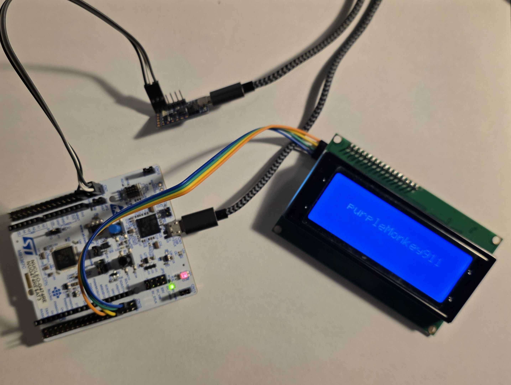

# lcd2004tty

## Overview
lcd2004tty is a TTY emulator application.  Data is sent from a host and is displayed on the LCD2004 LCD screen in real-time.  The LCD screen will wrap both horzontally and scroll vertically, as needed.

## Hardware pinout
This project utilizes the following:
- STM32G474RE Nucleo board
- FTDI LC231X USB-to-UART bridge (PC host connection)
- LCD2004 LCD screen with I2C interface

| Component                |  STM32G4 GPIO  | Nucleo32   | Notes
| ------------------------ |  ------------- | ---------- | ------ 
| LC231X UART Tx           |  PC11          | CN7 pin 2  | UART3 on STM32G4
| LC231X UART Rx           |  PC10          | CN7 pin 1  | UART3 on STM32G4
| LC231X GND               |  N/A           | CN7 pin 8  | GND
| LCD2004 GND              |  N/A           | CN10 pin 9 | GND
| LCD2004 Vcc              |  N/A           | CN10 pin 8 | 5V from STM32G4
| LCD2004 SCL              |  PB8           | CN10 pin 3 | I2C1 on STM32G4
| LCD2004 SDA              |  PB9           | CN10 pin 5 | I2C1 on STM32G4

## LCD2004 LCD Screen
The LCD2004 LCD screen is a LCD screen driven by a Hitachi HD44780 Controller. It contains a TI PCF8574T 8-bit expander for I2C communiation and control.  Despite this LCD being produced by numerous manufacturers, I haven't found good documentation for the I2C protocol.  The device driver used in this application was reversed engineered from various datasheets on the previously mentioned components and python and Arduino code written for this LCD.

## References
- STM32G4 Nucleo 64 ([User Manual](https://www.st.com/resource/en/user_manual/um2505-stm32g4-nucleo64-boards-mb1367-stmicroelectronics.pdf)) ([schematic](https://www.st.com/resource/en/schematic_pack/mb1367-g474re-d01-schematic.pdf))
- [FTDI LC231X USB-to-UART bridge](https://ftdichip.com/products/lc231x/)
- [LCD2004 LCD](https://www.handsontec.com/pdf_files/GDM2004DFLYBW.pdf)
- [Hitachi HD44780 LCD controller](https://www.crystalfontz.com/controllers/uploaded/Hitachi%20HD44780%20v0.0.pdf)
- Texas Instruments PCF8574 8-bit I/O Expander  ([TI datasheet](https://www.ti.com/lit/ds/symlink/pcf8574.pdf))  ([HandsOnTech datasheet](https://handsontec.com/dataspecs/module/I2C_LCD_Interface.pdf))
